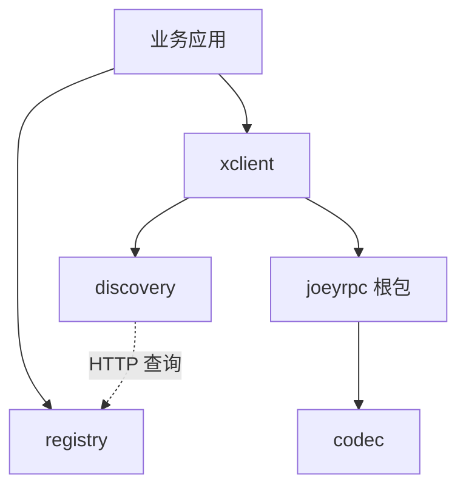

# JoeyRPC 架构

## 模块与依赖



- `joeyrpc`：单条连接上的 RPC 调用、服务注册和处理。`option.go` 管理初始化参数，`dial.go` 管理建连，`http.go` 适配 HTTP CONNECT。
- `codec`：消息头、编解码接口及 Gob 实现。当前只实现 Gob；JSON 类型常量仍是预留接口。
- `discovery`：实例列表、缓存刷新、随机/轮询选址。只处理地址，不持有 RPC 连接。
- `xclient`：依赖 `discovery.Discovery` 接口，按地址复用根包的 `Client`，提供单实例调用与广播。
- `registry`：独立 HTTP 处理器，以内存表记录实例和心跳时间；`heartbeat.go` 负责服务端主动注册与续约。

注册中心不转发业务请求。服务端启动后向其发送心跳，客户端发现实例后直接连接服务端。

## 调用流程

1. `Server.Register` 反射扫描接收者方法，建立服务名、方法名与参数类型的映射。
2. `XClient.Call` 从发现接口取得地址，查找或建立该地址的连接。
3. 新连接发送 JSON `Option`，服务端校验魔数和编码类型；之后消息使用 Gob。
4. 客户端为调用分配 `Seq` 并写入 `pending`，发送消息头和参数。
5. 服务端顺序读取请求，用独立 goroutine 执行方法，通过写锁发送完整响应。
6. 客户端接收循环按 `Seq` 找到调用，解码结果并通知 `Done`；`Call` 等待完成或 context 取消。

`Client` 支持同一连接上的多个未完成请求，响应按序号匹配。`XClient` 缓存的是每个地址的一条可用连接。

广播为每个实例创建独立结果对象，记录第一个成功结果，等待所有客户端调用结束。任一调用失败会取消其他调用的本地等待；广播返回首个记录的错误。

## 协议兼容

模块路径为 `github.com/Joey0v0/JoeyRPC`，根包名为 `joeyrpc`。原有线上协议值继续保留：

| 项目 | 保留值 |
| --- | --- |
| 魔数 | `0x3bef5c` |
| 初始化配置 | JSON 编码的 `Option`，字段名不变 |
| RPC 消息头 | `ServiceMethod`、`Seq`、`Error` |
| 默认编码 | `application/gob` |
| HTTP RPC 路径 | `/_geeprc_` |
| HTTP CONNECT 状态文本 | `200 Connected to Gee RPC` |
| 调试页路径 | `/debug/geerpc` |
| 默认注册中心路径 | `/_geerpc_/registry` |
| 注册/心跳请求头 | `X-Geerpc-Server` |
| 实例列表响应头 | `X-Geerpc-Servers` |

HTTP CONNECT 成功后，连接切换到 RPC 字节流。调试页标题更新为 JoeyRPC。

默认连接超时为 10 秒，服务端处理超时为 0（不限）。注册中心默认实例有效期为 5 分钟，默认心跳间隔为 4 分钟；发现列表默认缓存 10 秒，过期后在下一次查询时刷新。过期实例在注册中心收到列表查询时被清理。

## 实现边界

当前实现具有以下限制：

- context 取消主要控制客户端等待，不传到服务端，也不覆盖发现、建连和发送的整个过程。
- 处理超时不会停止业务方法；现有处理超时与建连超时的无缓冲通知通道有 goroutine 滞留风险。
- 注册中心保存全局地址列表，没有按服务名分组、持久化或高可用机制。
- 心跳遇到网络错误会停止后续发送；发现和心跳的 HTTP 请求缺少显式超时及完整的响应资源处理。
- 服务方法校验和非法请求处理仍有边界情况需要补强；目前没有流式调用、自动重试或完整的服务治理能力。

后续修复应配合相应回归测试验证。

## 验证

```sh
go test -count=1 ./...
go vet ./...
go run ./examples/registry
```

原有测试覆盖反射注册和超时；新增测试覆盖 TCP/HTTP 调用、并发和异步调用、注册发现、随机/轮询选择、缓存刷新及广播。Unix Socket 测试仅在 Linux 上执行。
