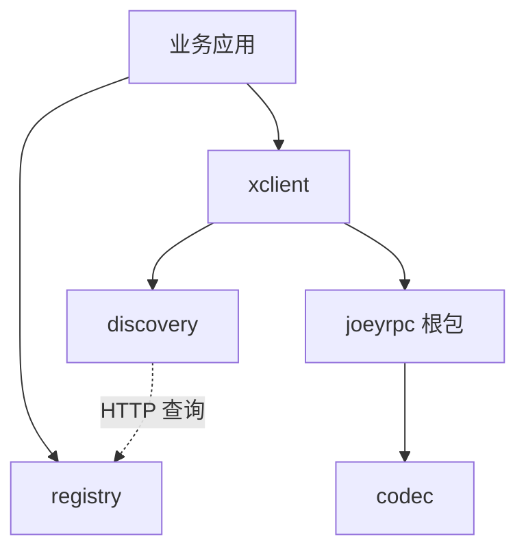

# JoeyRPC 架构

## 模块与依赖



- `joeyrpc`：单连接 RPC 核心。客户端为每个请求管理独立的完成状态；服务端为每条连接建立会话，由单一写协程发送响应。服务方法在注册时绑定，调用时直接执行缓存的绑定方法。
- `codec`：消息头、编解码接口及 Gob 实现。Gob 的写锁覆盖消息头、正文和刷新操作，关闭由 `sync.Once` 管理。当前只实现 Gob；JSON 类型常量仍是预留接口。
- `discovery`：维护地址快照与随机/轮询游标。远程刷新锁与地址列表锁分离，并发刷新共享一次查询；显式更新不会被正在进行的刷新覆盖。
- `xclient`：依赖 `discovery.Discovery` 接口，为每个地址协调建连并缓存可用连接。广播工作协程写入独立结果，收集者负责选取返回值与触发取消。
- `registry`：独立 HTTP 处理器，以内存表记录实例的最新续约时间，在查询时清理过期记录并排序。`heartbeat.go` 负责立即注册及周期续约，失败时仍停止续约循环。

注册中心不转发业务请求。服务端启动后向其发送心跳，客户端发现实例后直接连接服务端。

## 调用流程

1. `Server.Register` 反射扫描接收者方法，建立服务名、方法名与参数类型的映射。
2. `XClient.Call` 从发现接口取得地址，查找或建立该地址的连接。
3. 新连接发送 JSON `Option`，服务端校验魔数和编码类型；之后消息使用 Gob。
4. 客户端为调用分配 `Seq` 并登记请求状态，在写锁内发送消息头和参数。
5. 服务端会话顺序读取请求，分配独立参数与结果对象，并发执行绑定的方法。处理结果进入响应队列，由连接唯一的写协程发送。
6. 客户端接收循环按 `Seq` 找到请求，取得该请求的结果访问权后解码并通知 `Done`。取消与解码共享请求锁，`Call` 返回后不会再写入其结果对象。

`Client` 支持同一连接上的多个未完成请求，响应按序号匹配。`XClient` 缓存的是每个地址的一条可用连接。

广播为每个实例创建独立结果对象，记录第一个成功结果，等待所有客户端调用结束。任一调用失败会取消其他调用的本地等待；广播返回首个记录的错误。

## 协议兼容

模块路径为 `github.com/Joey0v0/JoeyRPC`，根包名为 `joeyrpc`。HTTP 协议名称已统一为 JoeyRPC；JSON 与 Gob 消息结构保持不变：

| 项目 | 保留值 |
| --- | --- |
| 魔数 | `0x3bef5c` |
| 初始化配置 | JSON 编码的 `Option`，字段名不变 |
| RPC 消息头 | `ServiceMethod`、`Seq`、`Error` |
| 默认编码 | `application/gob` |
| HTTP RPC 路径 | `/_joeyrpc_` |
| HTTP CONNECT 状态文本 | `200 Connected to JoeyRPC` |
| 调试页路径 | `/debug/joeyrpc` |
| 默认注册中心路径 | `/_joeyrpc_/registry` |
| 注册/心跳请求头 | `X-Joeyrpc-Server` |
| 实例列表响应头 | `X-Joeyrpc-Servers` |

HTTP CONNECT 成功后，连接切换到 RPC 字节流。HTTP 和 JSON 解析器预读的剩余字节会交给下一层解析器。调试页按服务名、方法名排序，展示签名和调用次数。

HTTP 命名调整没有保留旧路径或旧请求头的别名。旧版 HTTP 客户端、注册中心、心跳发送端和服务发现端必须同步升级；手动配置的注册中心 URL、调试页地址也要更新。直接 TCP 调用的 JSON/Gob 协议没有改变。

默认连接超时为 10 秒，服务端处理超时为 0（不限）。注册中心默认实例有效期为 5 分钟，默认心跳间隔为 4 分钟；发现列表默认缓存 10 秒，过期后在下一次查询时刷新。过期实例在注册中心收到列表查询时被清理。

## 实现边界

当前实现具有以下限制：

- context 取消主要控制客户端等待，不传到服务端，也不覆盖发现、建连和发送的整个过程。
- 若响应已开始解码，取消会等待该次解码释放结果对象；因此 context 不保证严格按 deadline 返回。这个取舍避免调用返回后仍有接收协程修改结果。
- 处理超时不会停止业务方法。框架使用带缓冲的完成通道，方法结束后能释放内部通知协程，但无法强制终止业务方法本身。
- 注册中心保存全局地址列表，没有按服务名分组、持久化或高可用机制。
- 心跳遇到网络或 HTTP 状态错误会停止后续发送。发现与心跳已关闭响应体，但仍沿用无显式请求超时的 HTTP 客户端行为。
- 客户端调用仍在发出请求后等待 context，未增加端到端 deadline、流式调用或自动重试。
- `codec.NewCodecFuncMap` 是公开的普通 map，应在启动连接之前配置，不支持在连接创建期间并发修改。

后续修复应配合相应回归测试验证。

## 验证

```sh
go test -count=1 ./...
go vet ./...
go run ./examples/registry
```

测试覆盖 TCP/HTTP 调用、反射注册、容器结果、并发和异步调用、注册发现、随机/轮询选择及广播；另外验证了合并到同一次读取的配置与请求、异常请求后的连接复用、取消期间解码、迟到构造器释放、刷新竞争、写入失败和并发关闭。

Unix Socket 测试仅在 Linux 上执行。逐目录改动与兼容性验证见[实现重写记录](rewrite.md)。
